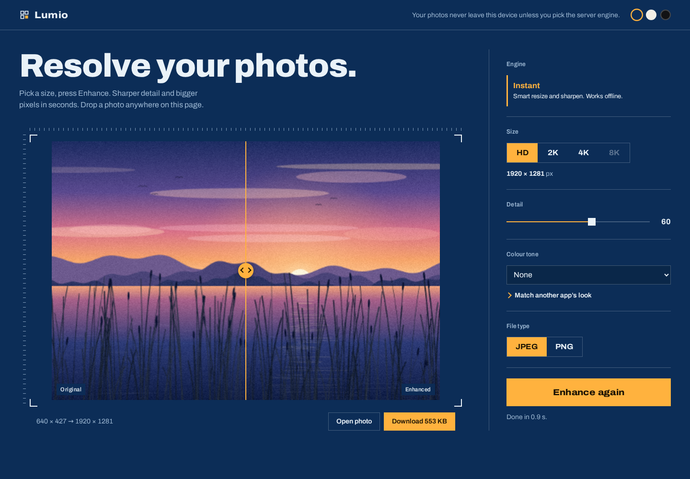
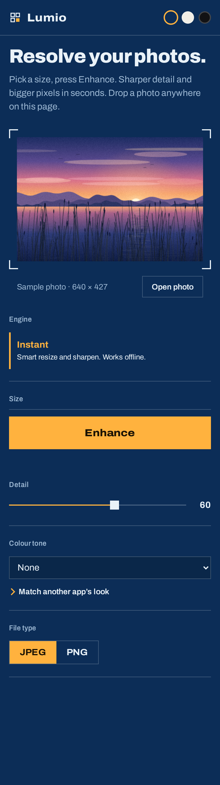

<div align="center">

# Lumio Enhancer

**Free photo enhancer that runs in your browser.** Upscale to HD, 2K, 4K or 8K, sharpen detail, and match another app's colour look — without uploading your photos anywhere.

[🚀 Open the live app](https://rajesh-k01.github.io/lumio-net/) · [Report an issue](https://github.com/rajesh-k01/lumio-net/issues)



</div>

---

## What it is

Lumio is a **static, no-build web app**. Clone it, drop it on any static host, and it works — there is no framework, no bundler, and no server required for the default engine.

- **Your photos never leave your device.** Every engine except the optional *Server* engine runs entirely in the browser.
- **Works offline** (after the first load) — the default *Instant* engine is pure canvas + Web Worker code.
- **The result is a real file.** Download the enhanced photo as JPEG or PNG at the size you picked.

<p align="center">
  
</p>

## Engines

The page picks up whichever engines are available and hides the rest.

| Engine | What it does | Needs |
|---|---|---|
| **Instant** *(default)* | Resizes with high-quality smoothing, then an unsharp mask on **luminance only** — no colour fringes, with a soft threshold that spares noise. | Nothing. Ships with the site. |
| **LumioNet** | In-browser AI upscaling via ONNX Runtime Web, run in **tiles with context padding** so memory stays bounded on phones. | A trained `.onnx` model listed in `site/models/models.json`. |
| **Server** | Uploads the photo to a backend that runs the heavy model. Strongest quality, enables 8K. | A backend serving `GET /api/health` and `POST /api/enhance`. |

### Learn another app's look

Pick the same photo twice — your original, and the result from the app whose colours you like. Lumio fits a per-channel tone curve from the difference, stores it in your browser, and can apply it to any photo. You can merge several pairs into one profile.

## Quick start

Any static server works. There is nothing to build.

```bash
git clone https://github.com/rajesh-k01/lumio-net.git
cd lumio-net
python3 -m http.server -d site 8000
# → http://localhost:8000
```

Use `localhost`, not `file://` — the app is built from ES modules and a module Web Worker, which browsers refuse to load from the filesystem.

## Repo layout

```
lumio-net/
├── site/                  ← the published app (this is what GitHub Pages serves)
│   ├── index.html
│   ├── css/style.css
│   ├── js/
│   │   ├── app.js         ← app wiring, UI state, enhancement flow
│   │   ├── config.js      ← all settings live here
│   │   ├── resolve.js     ← the "resolve" animation (coarse blocks → full detail)
│   │   ├── sample.js      ← the generated sample photo
│   │   ├── tone.js        ← tone-curve fitting and application
│   │   ├── ui.js          ← toasts, sliding bars, range fills
│   │   ├── util.js
│   │   ├── engines/       ← instant-core, tiled inference, server client
│   │   └── workers/       ← engine.worker.js (all heavy pixel work)
│   ├── models/            ← trained .onnx models + models.json
│   └── assets/fonts/      ← Archivo (SIL OFL)
├── dev/                   ← tests and dev tooling (not published)
│   ├── deploy.sh          ← publishes site/ to the gh-pages branch
│   ├── ci/deploy-pages.yml← GitHub Actions workflow (copy to .github/workflows/)
│   ├── tests/             ← node:test unit + ONNX parity tests
│   ├── e2e/               ← Playwright browser tests + verify.py (live-site check)
│   └── fixtures/          ← toy model + Python parity reference
└── docs/                  ← screenshots used by this README
```

## Configuration

Everything is in [`site/js/config.js`](site/js/config.js) — no rebuild required.

```js
export default {
  apiBase: null,     // null = server engine off; "" = same origin; "https://api.example.com" = another host
  modelsIndex: "models/models.json",
  ortUrl: "https://cdn.jsdelivr.net/npm/onnxruntime-web@1.30.0/dist/ort.wasm.min.mjs",
  providers: ["wasm"],          // use ["webgpu", "wasm"] for GPU speed
  tile: 128,                    // tile edge in input pixels
  pad: 24,                      // context pixels around each tile
  maxInputLongSide: 6000,       // larger photos are scaled down on load
  maxBrowserLongSide: 3840,     // largest output the in-browser engines will make (4K)
};
```

To be fully self-hosted, copy `ort.wasm.min.mjs` and the `ort-wasm-simd-threaded.*` files into `site/vendor/` and point `ortUrl` there.

### Adding a LumioNet model

Put the `.onnx` file in `site/models/` and list it in `site/models/models.json`:

```json
{ "models": [ { "id": "lumionet-x2", "name": "LumioNet", "file": "models/lumionet-x2.onnx", "scale": 2 } ] }
```

Input must be float32 `[1,3,h,w]` RGB in `0..1`, output `[1,3,scale*h,scale*w]`. The first model in the list is the one that runs. See [`site/models/README.md`](site/models/README.md).

## Deployment

The `site/` folder is the whole app. Publish it anywhere that serves static files.

### GitHub Pages (this repo)

The `gh-pages` branch holds the published site, so publishing is one command:

```bash
./dev/deploy.sh     # copies site/ onto gh-pages and pushes it
```

GitHub Pages serves that branch at **https://rajesh-k01.github.io/lumio-net/**.

The first time, a repo admin has to switch Pages on (GitHub keeps this setting per repository):

*Settings → Pages → Build and deployment → Source: **Deploy from a branch** → Branch: **gh-pages** → Folder: **/ (root)** → Save.*

After that, every `./dev/deploy.sh` (or push to `gh-pages`) republishes the site automatically.

**Prefer CI?** Copy `dev/ci/deploy-pages.yml` to `.github/workflows/deploy-pages.yml` and set the Pages source to **GitHub Actions**. Every push to `main` then deploys itself — no local command needed.

### Other hosts

- **Netlify** — drag the `site` folder onto [app.netlify.com/drop](https://app.netlify.com/drop)
- **Cloudflare Pages** — Create project → Direct upload → choose `site`
- **Vercel** — `vercel site` (framework: Other)

All of them provide HTTPS, which the app expects.

## Tests

```bash
cd dev && npm install     # onnxruntime-web, needed for the parity test
npm test                  # 14 unit + ONNX parity tests (node:test)

# browser tests (Playwright)
python3 e2e/serve.py ../site 8766 &
python3 e2e/full.py       # full suite, writes screenshots to dev/e2e/shots/

# check a published site end to end (loads it, enhances a photo, checks the download)
python3 e2e/verify.py https://rajesh-k01.github.io/lumio-net/
```

The parity test runs the exported toy model through the JavaScript tiler and compares it against the canonical Python `run_tiled()` output in `dev/fixtures/parity.json`. `e2e/verify.py` is the one that proves the *deployed* app works, not just the local copy.

## Honest status

- **No trained model is included.** LumioNet in `dev/` was only trained on toy shape images; it proves the pipeline runs in the browser, not that it beats other enhancers. Train it on real photos before relying on it.
- **Instant is classic upscaling and sharpening, not AI.** It is a solid, fast, private default — but it does not invent detail that isn't in the source.
- **The Server engine was tested only against the backend's fallback resizer here**, not SeedVR2 on a GPU.

## Credits

Font: [Archivo](https://fonts.google.com/specimen/Archivo) by Omnibus-Type, SIL Open Font License 1.1 — licence in [`site/assets/fonts/`](site/assets/fonts/).
